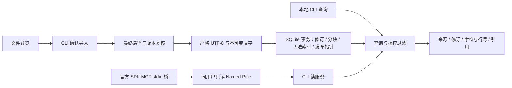

# 架构与数据主权

状态：第一阶段开发架构；2026-10-20。完整产品方向继承 v0.3 第 4、7、8 节，本文明确当前实现与后续职责。

CLI 管理入口能写台账，读服务与 MCP 不接受写操作。多个 MCP 进程复用一个指定库的读服务，不各自扫描磁盘、写库或装模型。管道只允许同一 Windows 用户；这不构成对同用户恶意程序的强隔离。

## 当前职责与失败边界

| 模块 | 已实现 | 边界 |
|---|---|---|
| Core | 路径/链接排除、预览复核、UTF-8、LF 规范化、code point 分块、IPC 限长 | 仅 MD/TXT；不枚举全盘、不读取 Cookie、不联网 |
| SQLite | 稳定来源、不可变修订、同源复用、当前发布指针、trigram/短词基线、撤销 | P1 同库事务，不承诺最终 schema；无持久队列、人工 overlay、完整备份迁移 |
| CLI | init/preview/import/status/search/fetch/withdraw/serve | 开发命令，不是正式安装器或完整产品 UI |
| MCP 桥 | 官方 SDK，search/fetch/status → 读管道 | 不直接访问数据库，无全局注册；协议探针不等于 Desktop 原生验收 |

原件为输入权威；SQLite 中不可变规范化文字为本阶段引用权威；命中中的 `locator_target=normalized_artifact` 明确字符范围不是原始字节偏移。后续人工正文必须形成独立修订，不能冒充原文。

P1 将正文、索引和指针置于一个事务，减少样机一致性问题；正式队列、索引适配器和独立对象目录在下一阶段落地。外部引擎引入后，按 v0.3 发布事务设计拆开权威台账与派生索引，使用 outbox/幂等消费；不得将这次简化当作已验证跨库一致性。

## 必须保留的产品不变量

来源身份与内容身份分开；同正文不同来源不能合并授权。重复导入同源同 hash 复用修订；正文变化产生新修订；旧 fetch 不悄悄指向当前版。撤销及 `local_only` 在返回前复核；索引不是权限权威。默认不给 Agent 私人正文，CLI 显式 `--allow-agent` 才登记授权。

所有字符预算按序列化后的完整 JSON 计算；出处不能因预算不足而被删除。当前没有续取游标和语义排序，结果给出 `truncated` 及 `deterministic_source_order_p1`。不能用少量合成命中宣称整体中文召回或性能达标。

## 后续扩展

Obsidian 插件对接管理 API 与安全配对，不能直接改台账。PDF/网页解析保留逐页/快照定位与覆盖；持久任务处理暂停、取消、重试和发布竞争。同步要有明确触发、账号/授权和分层覆盖；记忆批准和规则整理各自保留产品合同。这些模块有实际实现时才创建工程目录。
